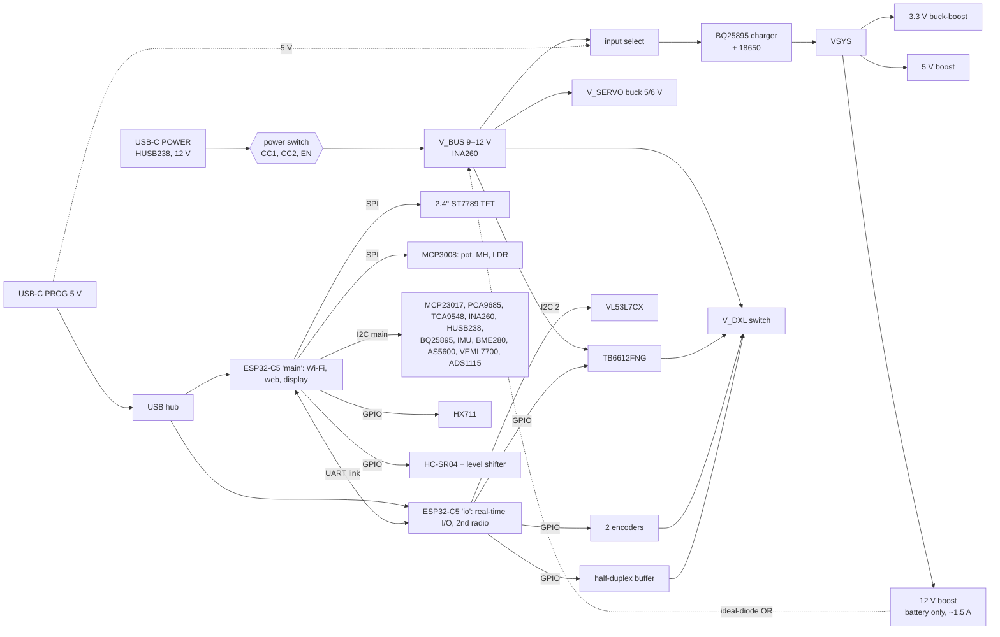

# SensorTestSetup PCB: specification (draft 0.3)

Status: **draft for review**. All decisions D1–D16 are settled (section 12); what is left are the *(verify)* items.
Values marked *(verify)* have to be checked against the datasheet before they go into the schematic.

Key words: **must** = hard requirement, **should** = strongly preferred, **may** = optional.

Designed together with the LynXP main PCB ([LynXP `Schematic/PCB_requirements.md`](https://github.com/vgroenhuis/LynXP)):
the same PD input, motor driver, Dynamixel port and I2C addresses, so the boards share parts and firmware drivers.

The PCB is designed by Claude (Fable 5.2) from this specification, and ordered and assembled at JLCPCB: prefer parts
from JLCPCB's assembly library (basic parts where possible), and give each chosen part its LCSC number *(verify stock)*.

## 1. Purpose

Replace the breadboard with one PCB carrying as many of the sensors as possible, for the permanent desk setup used to
explain and try out sensors and actuators, and for the CloSer lab demos page.

1. **It always works.** Power on and every part works; a missing, broken or disconnected part never stops the rest.
2. **Every part can be explained.** Parts are visible and labelled on the silkscreen (name, bus, address or pins), with
   test points for the scope and logic analyser.
3. **Easy to extend.** Spare connectors on every bus.
4. **Runs anywhere:** from USB-C PD, or for quick demos from its own 18650 cell (everything, the motors and servos at
   reduced current).

## 2. Lessons from the breadboard and the ESP-IDF firmware

| # | Finding | Consequence |
| --- | --- | --- |
| L1 | One ESP32-C5 has no free GPIO left (only GPIO27). | **Two ESP32-C5 modules** (section 4). |
| L2 | Strapping pins: GPIO15 is used by the PSRAM; GPIO27 has a pull-up; **GPIO28 must be HIGH at reset** (pull-up): use it only as an output, never driven from outside. The other strapping pins have no effect (no fuse bits set, GPIO28 high at boot). | Pin maps in section 5 follow this. |
| L3 | PCA9685 All-Call (0x70) = TCA9548 default address. | TCA9548 at **0x71**; PCA9685 at **0x41** (0x40 is the INA260, as on LynXP). |
| L4 | The VL53L7CX firmware upload (~84 kB) blocks a shared I2C bus for seconds. | The VL53L7CX gets **its own I2C bus** on the second ESP32. |
| L5 | The HC-SR04 ECHO output is 5 V. | **Level shifter** on ECHO. |
| L6 | The L298N: ~2 V drop, hot, no current sense. | **TB6612FNG**, as on LynXP. |
| L7 | Motor and logic share supplies on the breadboard. | Separate rails, servos on their own converter, star ground. |
| L8 | The WF100DPZ has a fixed address (0x6D). | Keep the TCA9548; its spare channels take more identical sensors. |
| L9 | Breadboard contacts are the main cause of "unreliable". | Everything soldered or on keyed, locking connectors. |
| L10 | Motor-driver signals that float at reset can start a motor. | Pull-downs on all PWM and direction lines; PCA9685 OE pulled high (outputs off) until firmware enables it. |

## 3. Block diagram

## 4. Two ESP32-C5s

* **Must**: two ESP32-C5-WROOM-1 modules with PSRAM (N16R8, as now) *(verify availability)*.
* **ESP 'main'**: Wi-Fi, web server, lab demos reports and updates, the display, the SPI parts (MCP3008, TFT), the main I2C
  bus, the HX711 and the ultrasonic sensor.
* **ESP 'io'**: the parts that need many pins or exact timing: motor driver and encoders, the VL53L7CX on its own bus,
  the Dynamixel port. Its own radio can search for a stronger Wi-Fi network or run an access point while 'main' stays
  responsive.
* **Link** between them: **UART** at 2–5 Mbit/s (D10). Reasons: the ESP32-C5 has **one general-purpose SPI controller** (SPI2); as an SPI slave, 'io' would have none left,
  and the SPI link takes 5 pins on each side against 2 for UART (section 5 is full with SPI). The data is small: a ToF
  frame (8×8) is ~1 kB at 15 Hz, under 20 kB/s; a 3 Mbit/s UART carries ~300 kB/s.
* **Programming**: one USB-C **PROG** port with a USB 2.0 hub (e.g. CH334 or FE1.1s *(verify)*) to both modules'
  native USB (GPIO13/14): two serial ports and JTAG, no USB-UART chips. 5.1 kΩ Rd on CC, ESD protection (USBLC6-2 or
  similar) on D+/D−. Each module: EN reset button, BOOT button on GPIO28, EN RC delay (10 kΩ / 1 µF).
* **Should**: a UART0 header (GND, TX, RX, EN, BOOT) on 'main' for flashing with an external adapter.
* Antennas: WROOM-1 modules with **PCB antennas** (D14), keep-out zones per the module datasheet, the two antennas on
  **opposite board edges**, away from the motor driver, the converters and the battery.

## 5. Pins

Usable per module: GPIO 0–12 and 23–28 (13/14: USB; 15–22: flash/PSRAM). GPIO27 has a pull-up; GPIO28 is pulled up
and output-only (section 2, L2). The designer may reassign pins; changes are documented so `firmware/main/board.h`
follows.

### ESP 'main'

| GPIO | Function | Notes |
| --- | --- | --- |
| 0 | SPI MISO | MCP3008 |
| 1 | HX711 SCK | |
| 2 / 3 | I2C main SDA / SCL | 2.2 kΩ pull-ups on board |
| 4 | HC-SR04 ECHO | through the level shifter |
| 5 | HX711 DOUT | |
| 6 | HC-SR04 TRIG | |
| 7 / 8 | SPI SCLK / MOSI | TFT and MCP3008 |
| 9 | TFT DC | |
| 10 | TFT RES | |
| 11 / 12 | UART0 header | console / external flashing |
| 23 / 26 | link UART TX / RX | 'main' TX 23 → 'io' RX 23; 'io' TX 26 → 'main' RX 26 |
| 24 | TFT BLK (backlight PWM) | LEDC |
| 25 | TFT CS | |
| 27 | RGB status LED (WS2812/SK6812) | pull-up is harmless |
| 28 | MCP3008 CS | output, idles high: fits the strap |

### ESP 'io'

| GPIO | Function | Notes |
| --- | --- | --- |
| 0 / 1 | TB6612 PWMA / PWMB | LEDC 20–30 kHz; pull-downs |
| 2 / 3 | I2C 2 SDA / SCL (VL53L7CX) | 2.2 kΩ pull-ups; 1 MHz possible |
| 4 | VL53L7CX INT | optional (firmware polls now) |
| 5 / 6 | TB6612 AIN1 / AIN2 | pull-downs |
| 7 / 8 | TB6612 BIN1 / BIN2 | pull-downs |
| 9 / 10 | encoder motor A: A / B | PCNT |
| 11 | Dynamixel DIR | UART RS-485 half-duplex RTS; weak pull-down |
| 12 | Dynamixel RX | |
| 23 / 26 | link UART RX / TX | |
| 24 / 25 | encoder motor B: A / B | PCNT |
| 27 | Dynamixel TX | idles high, the pull-up is harmless |
| 28 | TB6612 STBY | output; high at reset (pull-up) = driver on, but PWM is pulled down, so the motors are off |

All 19 usable pins of 'io' are used; 'main' has 11/12 left for the UART0 header.

## 6. Power

| Rail | Source | Rating | Loads |
| --- | --- | --- | --- |
| VBUS_PD | USB-C **POWER**, HUSB238 PD sink (I2C 0x08), default **12 V**, jumper for 9 V *(no 15/20 V options: TB6612 VM and the charger)* | 3 A | |
| **V_BUS** | VBUS_PD after the load switch (closes on a valid contract, soft start), or the 12 V battery boost when there is no PD (ideal-diode OR); then the INA260 | 3 A from PD, ~1.5 A from the battery | TB6612 VM, V_SERVO, V_DXL, charger input (PD only) |
| **VSYS** | BQ25895 power path (I2C 0x6A) from V_BUS or VBUS_PROG (input selector, e.g. TPS2121 *(verify)*), and the **18650** | 3 A | 3.3 V and 5 V converters |
| **3.3 V** | buck-boost from VSYS (e.g. TPS63020 *(verify)*) | ≥ 1.5 A | both ESP32s (Wi-Fi peaks ~0.5 A each), sensors, TFT |
| **5 V** | boost from VSYS | ≥ 1 A | HC-SR04, level shifter, Dynamixel buffer (if 5 V), exposed 5 V |
| **12 V boost** | from VSYS, **only without PD** (enabled by the charger's "no input" state or by firmware *(verify)*), current limit ~1.5 A | ~18 W | V_BUS on battery |
| **V_SERVO** | buck from V_BUS, jumper 5 / 6 V | ≥ 3 A | 8 servo headers, ≥ 470 µF bulk |
| **V_DXL** | V_BUS through a load switch with current limit, enabled by the MCP23017 (pull-down: off at reset) | ≥ 3 A | Dynamixel only (9–12 V; the XL430 takes 6.5–12 V) |

* **Battery** (D11): one 18650 in a holder on the back, charged from either USB-C, for **quick demos without external
  power**. Everything runs on it: the logic and sensors take about 1.5 W (6–7 hours from a 3000 mAh cell *(estimate)*);
  a 12 V boost supplies V_BUS for the motors, servos and Dynamixel at up to ~1.5 A (18 W, so 5–6 A from the cell: a
  **high-drain cell** of ≥ 10 A, e.g. Samsung 30Q or Molicel P28A *(verify)*, and a boost converter rated for it, e.g.
  TPS61088 *(verify)*). The firmware reads the battery (BQ25895) and the current (INA260) and limits the motor PWM and
  servo moves on battery; the charger's power path and the cell's protection must carry the boost's input current
  *(verify the BQ25895 BATFET rating)*.
* **Power switch** (like LynXP §2.2): one multi-pole switch breaks **CC1 and CC2** (so a powerbank wakes up on every
  switch-on and renegotiates) and the **enable of the 3.3 V and 5 V converters** (so the battery doesn't drain). Charging
  continues while switched off. No separate emergency stop: the motors run free, and the firmware stops them (STBY, PWM).
* **Monitoring**: the INA260 measures everything on V_BUS; the BQ25895's ADC reads battery voltage, charge current and
  input voltage; the HUSB238 reports the PD contract. All three on the main I2C bus, with a page in the firmware.
* Protection: TVS on VBUS_PD (≥ 15 V standoff) and VBUS_PROG; USB-C sink capacitance ≤ 10 µF before the load switch
  *(verify)*; bulk capacitors behind it; the battery with protection (in the charger, or a DW01-type protector *(verify)*).
* Power-good LEDs on V_BUS, 3.3 V, 5 V, V_SERVO, V_DXL; charge LED; test points on every rail.
* Exposed power (like LynXP §3.1): screw terminals and 2.54 mm headers for V_BUS, V_SERVO, 5 V, 3.3 V, GND, labelled
  with their voltage.

## 7. Parts on the board

### Sensors and inputs

| Part | Bus / pin | Address | Notes |
| --- | --- | --- | --- |
| Potentiometer (panel, with knob) | MCP3008 ch 7 | | front edge |
| MH sensor module socket: 4-pin female header (VCC, GND, DO, AO) for a standard MH module | MCP3008 ch 6 (AO), MCP23017 bank B (DO) | | VCC 3.3 V (5 V by jumper *(verify the AO level)*); the same channel as now |
| IR reflective sensor (e.g. ITR20001 or TCRT5000 *(verify)*) with LM393 comparator and threshold trimmer, on board (D13) | MCP3008 ch 4 (analog), MCP23017 bank B (digital) | | facing up or over the board edge; IR LED on a jumper |
| LDR (with divider) | MCP3008 ch 5 | | next to the VEML7700, to compare |
| MCP3008 | SPI ('main') | | ch 0–3 on analog input headers |
| ADS1115 16-bit ADC | I2C main | 0x48 | inputs on a header (compare with the MCP3008's 10 bits) |
| 2× WF100DPZ pressure | TCA9548 ch 0, 1 | 0x6D | hose barbs on the board edge |
| VL53L7CX ToF | I2C 2 ('io') | 0x29 | **on the board, facing up**: nothing taller within its 60° cone; AVDD and IOVDD 3.3 V *(verify)* |
| IMU (LSM6DSO or ICM-42688 *(verify)*) | I2C main | 0x6B (0x6A is the BQ25895) | |
| BME280 / BME688 | I2C main | 0x76 | away from the regulators (self-heating) |
| VEML7700 light | I2C main | 0x10 | |
| AS5600 magnetic angle + knob with magnet | I2C main | 0x36 | |
| INA260 current / power | I2C main | 0x40 | on V_BUS |
| HX711 | GPIO ('main') | | load cell on a connector; RATE on a jumper (10/80 Hz) |
| HC-SR04 | GPIO ('main') | | on a connector, level-shifted ECHO |
| Buttons (4) | MCP23017 bank B | | |
| Motor encoders (2) | PCNT ('io') | | 3.3 V supply, RC filter footprints (DNP) |

### Outputs

| Part | Bus / pin | Address | Notes |
| --- | --- | --- | --- |
| TFT 2.4" 240×320, ST7789 (Zhongjingyuan module: GND, VCC, SCL, SDA, RES, DC, CS, BLK) | SPI ('main') | | 8-pin female header, the module plugs in; mounting holes under it |
| MCP23017 | I2C main | 0x20 | bank A: 8 LEDs (A7 output-only *(verify)*); bank B: buttons, MH digital out, header; also V_DXL enable and PCA9685 OE |
| PCA9685 | I2C main | **0x41** | 8 servo headers (ch 0–7); ch 8: buzzer through a MOSFET; ch 9–15 on a header; OE pulled high until firmware enables |
| TCA9548 | I2C main | **0x71** | ch 0–1 pressure; ch 2–7 Qwiic connectors |
| TB6612FNG | GPIO ('io') | | two motor ports (A: the gear motor; B: spare), VM = V_BUS, thermal copper |
| Dynamixel XL430 port | UART ('io') | | as LynXP §11.3: 2× JST EH 3-pin (GND, V_DXL, DATA), tri-state buffer pair (74LVC2G241 or 2× 74LVC1G125) for half duplex, pull-up on DATA, logic level per the XL430 datasheet *(verify)* |
| RGB status LED | GPIO27 ('main') | | |
| HUSB238 | I2C main | 0x08 | |
| BQ25895 | I2C main | 0x6A | |

### I2C addresses (main bus)

0x08 HUSB238 · 0x10 VEML7700 · 0x20 MCP23017 · 0x36 AS5600 · 0x40 INA260 · 0x41 PCA9685 · 0x48 ADS1115 · 0x6A BQ25895 ·
0x6B IMU · 0x70 (PCA9685 All-Call: kept free) · 0x71 TCA9548 · 0x76 BME280. Behind the TCA9548: 0x6D ×2 + spares.
Second bus ('io'): 0x29 VL53L7CX + one Qwiic connector.

The PCA9685 stays on the main bus, not behind the TCA9548: with the TCA9548 at 0x71 there is no clash, and behind the
multiplexer every servo update would need a channel switch first (and stop when the multiplexer hangs). A second
PCA9685 (for more servos) could go behind it, as both would share an address.

The MCP23017 stays on I2C rather than an MCP23S17 on SPI: the SPI bus of 'main' carries the TFT's frames, and the I2C
bus has room now that the VL53L7CX has its own; the register map is the same, so the firmware could follow if needed.

## 8. Connectors

| Connector | Type | Count |
| --- | --- | --- |
| USB-C POWER | PD sink (CC, VBUS) | 1 |
| USB-C PROG | USB 2.0 data + 5 V | 1 |
| 18650 holder | through-hole, on the back | 1 |
| Motor + encoder | JST-PH 6-pin (M+, M−, VCC, GND, A, B) + 2-pin screw terminal, in parallel | 2 (A, B; D16) |
| Servos | 3-pin 2.54 mm (GND, V_SERVO, signal), ~220 Ω series resistors | 8 |
| Dynamixel | JST EH 3-pin (B3B-EH-A *(verify)*), in parallel | 2 |
| Load cell | JST-PH 4-pin (E+, E−, A+, A−) | 1 |
| HC-SR04 | 4-pin 2.54 mm female (VCC, TRIG, ECHO, GND) | 1 |
| Qwiic / STEMMA QT (JST-SH 4-pin, 3.3 V) | main bus: 2; behind the TCA9548: 6; 'io' bus: 1 | 9 |
| Analog in (GND, 3.3 V, signal) | MCP3008 ch 0–3, ADS1115 ch 0–3 | 8 |
| MH sensor module | 4-pin female (VCC, GND, DO, AO) | 1 |
| MCP23017 bank B header | 2×5 (I/O, GND, 3.3 V) | 1 |
| PCA9685 ch 9–15 header | with GND and 5 V | 1 |
| TFT | 8-pin 2.54 mm female | 1 |
| UART0 ('main') | 5-pin: GND, TX, RX, EN, BOOT | 1 |
| Exposed power | screw terminals + headers (section 6) | 1 set |

## 9. Robustness ("always works")

* The board boots the same whatever is plugged in: no connector pin reaches a strapping pin; GPIO28 only drives.
* Every actuator is off until firmware enables it: PWM and direction lines pulled down, PCA9685 OE pulled high,
  V_DXL off.
* Each part reports present / absent in firmware (as now); a part that hangs a bus can't stop the other ESP32 or the
  other bus.
* ESD protection on the USB data lines and on the Qwiic and sensor connectors that leave the board.

## 10. Mechanical

* About 100 × 150 mm, larger where needed (all the parts above have priority over size). 4× M3 mounting holes.
* Front edge: TFT, potentiometer, AS5600 knob, buttons, power switch. Rear/side edges: USB-C, motor, servo, Dynamixel and
  sensor connectors, pressure hose barbs.
* VL53L7CX facing up with a clear 60° cone; the light sensors (LDR, VEML7700) uncovered; the BME280 away from heat.
* Silkscreen: every part's name, bus and address; connector pin names and voltages; board name and revision.

## 11. Firmware impact

* Split into two applications: **main** (the present firmware minus the 'io' parts) and **io** (motor, encoders,
  ToF, Dynamixel), with a link protocol between them; both report to the lab demos server (two devices, or one with
  the other as a part: to decide in firmware).
* TFT: ST7789 through `esp_lcd` (u8g2 is monochrome), with a simple drawing layer or LVGL.
* Address changes: PCA9685 0x41, TCA9548 0x71 (constants in `i2cbus.c`).
* New drivers and pages: IMU, BME280, VEML7700, AS5600, ADS1115, INA260, HUSB238, BQ25895 (battery and PD page), LDR,
  IR reflective sensor, Dynamixel (Protocol 2.0), a second motor; all of them matrix inputs or outputs.
* On battery: limit the motor PWM and servo moves to the boost's current (INA260), and show the battery on the display.

## 12. Decisions

| # | Decision |
| --- | --- |
| D1 | ESP32-C5 modules on the board (now two: section 4). |
| D2 | Motors and servos run from USB-C PD (12 V), like LynXP from a powerbank; plus an 18650 for the rest. |
| D3 | A 2.4" 240×320 ST7789 TFT module (in stock). |
| D4 | VL53L7CX on the board, facing up. |
| D5 | ~100 × 150 mm, may grow. |
| D6 | All candidate sensors on the board. |
| D7 | 8 servo headers. |
| D8 | TB6612FNG. |
| D9 | Designed by Claude (Fable 5.2), ordered and assembled at JLCPCB. |
| D10 | UART link between the two ESP32s. |
| D11 | The 18650 powers everything for quick demos: a 12 V boost (~1.5 A) feeds the motors and servos without PD. |
| D12 | No extra PWM chip for the motor driver: PWM from 'io' (LEDC). |
| D13 | An on-board IR reflective sensor, plus a 4-pin socket for a standard MH sensor module. |
| D14 | WROOM-1 modules with PCB antennas at opposite edges. |
| D15 | I2C addresses as on LynXP (PCA9685 0x41, INA260 0x40): no preference, so aligned. |
| D16 | A second motor port on the TB6612's channel B. |

## 13. Next steps

1. Verify the *(verify)* items and choose parts with LCSC numbers.
2. Schematic in `OfficeDeskSetup/` (the present one has the DevKit, MCP3008, MCP23017, TCA9548, L298N and the pot).
3. Layout, JLCPCB order, and bring-up part by part (the firmware already reports each part as found or not).
