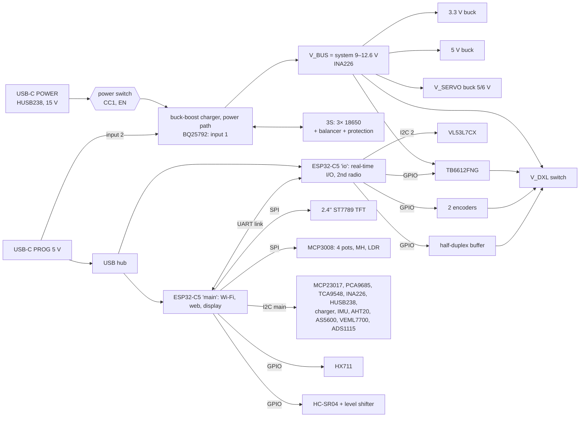

# SensorTestSetup PCB: specification (draft 0.7)

Status: **draft for review**. All decisions D1–D16 are settled (section 12). Draft 0.7: the parts list with JLCPCB
numbers and stock (section 14), corrected after a fuller search (the HUSB238, AS5600, BQ77915 and the ESP32-C5-WROOM-1U
are in stock); D14 settled on the WROOM-1U with external antennas. The remaining *(verify)* items are datasheet details.
Values marked *(verify)* have to be checked against the datasheet before they go into the schematic.

Key words: **must** = hard requirement, **should** = strongly preferred, **may** = optional.

Designed together with the LynXP main PCB ([LynXP `Schematic/PCB_requirements.md`](https://github.com/vgroenhuis/LynXP)):
the same PD input, motor driver, Dynamixel port and I2C addresses, so the boards share parts and firmware drivers.

The PCB is designed by Claude (Fable 5.2) from this specification, and ordered and assembled at JLCPCB: prefer parts
from JLCPCB's assembly library (basic parts where possible), and give each chosen part its LCSC number *(verify stock)*.

## 1. Purpose

Replace the breadboard with one PCB carrying as many of the sensors as possible, for the permanent desk setup used to
explain and try out sensors and actuators, and for the CloSer lab demos page.

1. **It always works.** Power on and every part works; a missing, broken or disconnected part never stops the rest.
2. **Every part can be explained.** Parts are visible and labelled on the silkscreen (name, bus, address or pins), with
   test points for the scope and logic analyser.
3. **Easy to extend.** Spare connectors on every bus.
4. **Runs anywhere:** from USB-C PD, or for quick demos from its own three 18650 cells (everything).

## 2. Lessons from the breadboard and the ESP-IDF firmware

| # | Finding | Consequence |
| --- | --- | --- |
| L1 | One ESP32-C5 has no free GPIO left (only GPIO27). | **Two ESP32-C5 modules** (section 4). |
| L2 | Strapping pins: GPIO15 is used by the PSRAM; GPIO27 has a pull-up; **GPIO28 must be HIGH at reset** (pull-up): use it only as an output, never driven from outside. The other strapping pins have no effect (no fuse bits set, GPIO28 high at boot). | Pin maps in section 5 follow this. |
| L3 | PCA9685 All-Call (0x70) = TCA9548 default address. | TCA9548 at **0x71**; PCA9685 at **0x41** (0x40 is the INA226, as LynXP's INA260). |
| L4 | The VL53L7CX firmware upload (~84 kB) blocks a shared I2C bus for seconds. | The VL53L7CX gets **its own I2C bus** on the second ESP32. |
| L5 | The HC-SR04 ECHO output is 5 V. | **Level shifter** on ECHO. |
| L6 | The L298N: ~2 V drop, hot, no current sense. | **TB6612FNG**, as on LynXP. |
| L7 | Motor and logic share supplies on the breadboard. | Separate rails, servos on their own converter, star ground. |
| L8 | The WF100DPZ has a fixed address (0x6D). | Keep the TCA9548; its spare channels take more identical sensors. |
| L9 | Breadboard contacts are the main cause of "unreliable". | Everything soldered or on keyed, locking connectors. |
| L10 | Motor-driver signals that float at reset can start a motor. | Pull-downs on all PWM and direction lines; PCA9685 OE pulled high (outputs off) until firmware enables it. |

## 3. Block diagram

## 4. Two ESP32-C5s

* **Must**: two **ESP32-C5-WROOM-1U-N16R8** modules (D14): 16 MB flash, 8 MB PSRAM as now, with a U.FL connector for an
  external antenna (as on LynXP). In stock at JLCPCB (C54951857, 684 pcs), unlike the WROOM-1 with PCB antenna.
* **ESP 'main'**: Wi-Fi, web server, lab demos reports and updates, the display, the SPI parts (MCP3008, TFT), the main I2C
  bus, the HX711 and the ultrasonic sensor.
* **ESP 'io'**: the parts that need many pins or exact timing: motor driver and encoders, the VL53L7CX on its own bus,
  the Dynamixel port. Its own radio can search for a stronger Wi-Fi network or run an access point while 'main' stays
  responsive.
* **Link** between them: **UART** at 2–5 Mbit/s (D10). Reasons: the ESP32-C5 has **one general-purpose SPI controller** (SPI2); as an SPI slave, 'io' would have none left,
  and the SPI link takes 5 pins on each side against 2 for UART (section 5 is full with SPI). The data is small: a ToF
  frame (8×8) is ~1 kB at 15 Hz, under 20 kB/s; a 3 Mbit/s UART carries ~300 kB/s.
* **Programming**: one USB-C **PROG** port with a USB 2.0 hub (CH334R, section 14) to both modules'
  native USB (GPIO13/14): two serial ports and JTAG, no USB-UART chips. 5.1 kΩ Rd on CC, ESD protection (USBLC6-2 or
  similar) on D+/D−. Each module: EN reset button, BOOT button on GPIO28, EN RC delay (10 kΩ / 1 µF).
* **Should**: a UART0 header (GND, TX, RX, EN, BOOT) on 'main' for flashing with an external adapter.
* Antennas: two **dual-band 2.4/5 GHz** antennas on U.FL cables (the board uses 5 GHz now: iotroam, channel 112), mounted
  at opposite ends of the board or the desk setup, away from the motor driver, the converters and the battery; mounting
  points (holes or adhesive areas) on the board. Keep the modules themselves away from those parts too.

## 5. Pins

Usable per module: GPIO 0–12 and 23–28 (13/14: USB; 15–22: flash/PSRAM). GPIO27 has a pull-up; GPIO28 is pulled up
and output-only (section 2, L2). The designer may reassign pins; changes are documented so `firmware/main/board.h`
follows.

### ESP 'main'

| GPIO | Function | Notes |
| --- | --- | --- |
| 0 | SPI MISO | MCP3008 |
| 1 | HX711 SCK | |
| 2 / 3 | I2C main SDA / SCL | 2.2 kΩ pull-ups on board |
| 4 | HC-SR04 ECHO | through a 74LVC1G34 at 3.3 V (5 V-tolerant input) |
| 5 | HX711 DOUT | |
| 6 | HC-SR04 TRIG | |
| 7 / 8 | SPI SCLK / MOSI | TFT and MCP3008 |
| 9 | TFT DC | |
| 10 | TFT RES | |
| 11 / 12 | UART0 header | console / external flashing |
| 23 / 26 | link UART TX / RX | 'main' TX 23 → 'io' RX 23; 'io' TX 26 → 'main' RX 26 |
| 24 | TFT BLK (backlight PWM) | LEDC |
| 25 | TFT CS | |
| 27 | RGB status LED (WS2812/SK6812) | pull-up is harmless |
| 28 | MCP3008 CS | output, idles high: fits the strap |

### ESP 'io'

| GPIO | Function | Notes |
| --- | --- | --- |
| 0 / 1 | TB6612 PWMA / PWMB | LEDC 20–30 kHz; pull-downs |
| 2 / 3 | I2C 2 SDA / SCL (VL53L7CX) | 2.2 kΩ pull-ups; 1 MHz possible |
| 4 | VL53L7CX INT | optional (firmware polls now) |
| 5 / 6 | TB6612 AIN1 / AIN2 | pull-downs |
| 7 / 8 | TB6612 BIN1 / BIN2 | pull-downs |
| 9 / 10 | encoder motor A: A / B | PCNT |
| 11 | Dynamixel DIR | UART RS-485 half-duplex RTS; weak pull-down |
| 12 | Dynamixel RX | |
| 23 / 26 | link UART RX / TX | |
| 24 / 25 | encoder motor B: A / B | PCNT |
| 27 | Dynamixel TX | idles high, the pull-up is harmless |
| 28 | TB6612 STBY | output; high at reset (pull-up) = driver on, but PWM is pulled down, so the motors are off |

All 19 usable pins of 'io' are used; 'main' has 11/12 left for the UART0 header.

## 6. Power

| Rail | Source | Rating | Loads |
| --- | --- | --- | --- |
| VBUS_PD | USB-C **POWER**, **HUSB238** PD sink (I2C 0x08, as LynXP), default **15 V** (voltage-select resistor *(verify)*), jumpers for 20 V / 12 V / 9 V | 3 A (45 W at 15 V) | charger input 1 |
| VBUS_PROG | USB-C **PROG** (5 V) | 0.5–1.5 A | USB hub, charger input 2 (slow charging, logic on a PC alone) |
| **V_BUS** | the charger's system output (NVDC power path): the battery voltage, **9–12.6 V**, from the inputs when present, from the pack otherwise; then the INA226 with a shunt | ≥ 5 A (the BQ25792's battery switch: 6 A continuous, higher peaks *(verify in the datasheet)*) | 3.3 V, 5 V, V_SERVO, TB6612 VM, V_DXL |
| **3.3 V** | buck from V_BUS | ≥ 1.5 A | both ESP32s (Wi-Fi peaks ~0.5 A each), sensors, TFT |
| **5 V** | buck from V_BUS | ≥ 1 A | HC-SR04, Dynamixel TX buffer and DATA pull-up, exposed 5 V |
| **V_SERVO** | buck from V_BUS, jumper 5 / 6 V | ≥ 3 A | 8 servo headers, ≥ 470 µF bulk |
| **V_DXL** | V_BUS through a load switch with current limit, enabled by the MCP23017 (pull-down: off at reset) | ≥ 3 A | Dynamixel only: 9–12.6 V, what the XL430 is made for (3S, nominal 11.1 V) |

* **Battery** (D11): **three 18650 cells in series (3S, 9–12.6 V)** in holders on the back, so the board runs fully
  without external power. The pack voltage is the system rail: the TB6612 (VM ≤ 13.5 V *(verify)*) and the Dynamixel run
  on it directly, with no 12 V boost; 18 W draws ~1.5 A from the cells; ~66 Wh from 3× 3000 mAh, so roughly two days for
  the logic and sensors alone *(estimate)*.
* **Charger**: a buck-boost charger with power path, two inputs, I2C and an ADC: **BQ25792** (or BQ25790; 1–4S, input
  3.6–24 V, integrated switches, I2C 0x6B) *(verify the part, its JLCPCB availability and its currents)*. Input 1: the
  PD port (15 V: ~45 W, charges in about 1.5 hours while the board runs); input 2: the PROG port (5 V: slow charging,
  ~8 hours). It charges from 5, 9, 12, 15 or 20 V, so any USB-C charger or powerbank works, a 15 V one best.
* **Cells**: high-drain 18650s; **3S protection with cell balancing: BQ77915** (3–5S protector, passive balancing,
  external charge/discharge MOSFETs; thresholds by variant *(verify for -04)*), so unprotected cells fit standard holders;
  an NTC on the cells for the charger and the protector.
* **Power switch**: drives the enable of a **load switch between the charger's system output and V_BUS**, so switched
  off, nothing on the board draws from the pack, and the charger keeps charging from either USB-C port. A DPDT
  toggle: the second pole breaks **CC1 only** (CC2 is direct), so a powerbank wakes up and renegotiates on every
  switch-on as on LynXP §2.2 when the plug lands on CC1; flip the plug to charge with the board switched off. A solder
  jumper (open) bypasses the CC1 pole. No separate emergency stop: the motors run free, and the firmware stops them (STBY, PWM).
* **Monitoring**: the INA226 measures everything the board uses (on V_BUS); the charger's ADC reads the input voltages
  and currents, the battery voltage and the charge current; the HUSB238 reports the PD contract. All three on the main I2C bus, with a page in the firmware.
* Protection: TVS on VBUS_PD (≥ 22 V standoff: 20 V can be selected) and VBUS_PROG; USB-C sink capacitance ≤ 10 µF
  before the charger *(verify)*; bulk capacitors on V_BUS; the cells' own protection.
* Power-good LEDs on V_BUS, 3.3 V, 5 V, V_SERVO, V_DXL; charge LED; test points on every rail.
* Exposed power (like LynXP §3.1): screw terminals and 2.54 mm headers for V_BUS, V_SERVO, 5 V, 3.3 V, GND, labelled
  with their voltage.

## 7. Parts on the board

### Sensors and inputs

| Part | Bus / pin | Address | Notes |
| --- | --- | --- | --- |
| Potentiometers (4, panel, with knob) | MCP3008 ch 0–3 (pots 0–3) | | front edge; e.g. one per servo |
| MH sensor module socket: 4-pin female header (VCC, GND, DO, AO) for a standard MH module | MCP3008 ch 6 (AO), MCP23017 bank B (DO) | | VCC 3.3 V (5 V by jumper *(verify the AO level)*); the same channel as now |
| IR reflective sensor ITR20001/T with LM393 comparator and threshold trimmer, on board (D13) | MCP3008 ch 4 (analog), MCP23017 bank B (digital) | | facing up or over the board edge; IR LED on a jumper |
| LDR (with divider) | MCP3008 ch 5 | | next to the VEML7700, to compare |
| MCP3008 | SPI ('main') | | ch 7 on an analog input header (ch 0–3: pots) |
| ADS1115 16-bit ADC | I2C main | 0x48 | inputs on a header (compare with the MCP3008's 10 bits) |
| 2× WF100DPZ pressure | TCA9548 ch 0, 1 | 0x6D | hose barbs on the board edge |
| VL53L7CX ToF | I2C 2 ('io') | 0x29 | **on the board, facing up**: nothing taller within its 60° cone; AVDD and IOVDD 3.3 V *(verify)* |
| IMU LSM6DS3TR-C | I2C main | 0x6A (0x6B is the charger) | |
| AHT20: temperature, humidity | I2C main | 0x38 | away from the regulators (self-heating); no barometer (none is cheap and in stock; the pressure demo is the WF100DPZ pair) |
| VEML7700 light | I2C main | 0x10 | |
| AS5600 magnetic angle + knob with magnet | I2C main | 0x36 | |
| INA226 current / power, with a shunt resistor | I2C main | 0x40 | on V_BUS |
| HX711 | GPIO ('main') | | load cell on a connector; RATE on a jumper (10/80 Hz) |
| HC-SR04 | GPIO ('main') | | on a connector, level-shifted ECHO |
| Buttons (4) | MCP23017 bank B | | |
| Toggle switches (2) | MCP23017 GPA4, GPA5 | | front edge; miniature SPDT with PCB pins (Dailywell 2MS1T1B1M1QES-5) |
| Motor encoders (2) | PCNT ('io') | | 3.3 V supply, RC filter footprints (DNP) |

### Outputs

| Part | Bus / pin | Address | Notes |
| --- | --- | --- | --- |
| TFT 2.4" 240×320, ST7789 (Zhongjingyuan module: GND, VCC, SCL, SDA, RES, DC, CS, BLK) | SPI ('main') | | 8-pin female header, the module plugs in; mounting holes under it |
| MCP23017 | I2C main | 0x20 | bank A: 4 LEDs, 2 toggle switches, GPA6/GPA7 free (A7 output-only *(verify)*); bank B: buttons, MH digital out, header; also V_DXL enable and PCA9685 OE |
| PCA9685 | I2C main | **0x41** | 8 servo headers (ch 0–7); ch 8: buzzer through a MOSFET; ch 9–15 on a header; OE pulled high until firmware enables |
| TCA9548 | I2C main | **0x71** | ch 0–1 pressure; ch 2–7 Qwiic connectors |
| TB6612FNG | GPIO ('io') | | two motor ports (A: the gear motor; B: spare), VM = V_BUS, thermal copper |
| Dynamixel XL430 port | UART ('io') | | as LynXP §11.3: 2× JST EH 3-pin (GND, V_DXL, DATA), DATA is **5 V TTL** (ROBOTIS: a level shifter for 3.3 V controllers): TX through a 74AHCT1G125 at 5 V (TTL inputs take 3.3 V), enabled by DIR (RTS, inverted in the UART if needed); RX through a 74LVC1G34 at 3.3 V (5 V-tolerant input); 10 kΩ pull-up on DATA to 5 V *(verify against the ROBOTIS communication circuit)* |
| RGB status LED | GPIO27 ('main') | | |
| HUSB238 PD sink | I2C main | 0x08 | |
| Charger (BQ25792) | I2C main | 0x6B *(verify)* | |

### I2C addresses (main bus)

0x08 HUSB238 · 0x10 VEML7700 · 0x20 MCP23017 · 0x36 AS5600 · 0x40 INA226 · 0x41 PCA9685 · 0x48 ADS1115 · 0x6A IMU ·
0x6B charger · 0x70 (PCA9685 All-Call: kept free) · 0x71 TCA9548 · 0x38 AHT20. Behind the TCA9548: 0x6D ×2 + spares.
Second bus ('io'): 0x29 VL53L7CX + one Qwiic connector.

The PCA9685 stays on the main bus, not behind the TCA9548: with the TCA9548 at 0x71 there is no clash, and behind the
multiplexer every servo update would need a channel switch first (and stop when the multiplexer hangs). A second
PCA9685 (for more servos) could go behind it, as both would share an address.

The MCP23017 stays on I2C rather than an MCP23S17 on SPI: the SPI bus of 'main' carries the TFT's frames, and the I2C
bus has room now that the VL53L7CX has its own; the register map is the same, so the firmware could follow if needed.

## 8. Connectors

| Connector | Type | Count |
| --- | --- | --- |
| USB-C POWER | PD sink (CC, VBUS) | 1 |
| USB-C PROG | USB 2.0 data + 5 V | 1 |
| 18650 holder | through-hole, on the back | 3 |
| Motor + encoder | JST-PH 6-pin (M+, M−, VCC, GND, A, B) + 2-pin screw terminal, in parallel | 2 (A, B; D16) |
| Servos | 3-pin 2.54 mm (GND, V_SERVO, signal), ~220 Ω series resistors | 8 |
| Dynamixel | JST EH 3-pin (B3B-EH-A *(verify)*), in parallel | 2 |
| Load cell | JST-PH 4-pin (E+, E−, A+, A−) | 1 |
| HC-SR04 | 4-pin 2.54 mm female (VCC, TRIG, ECHO, GND) | 1 |
| Qwiic / STEMMA QT (JST-SH 4-pin, 3.3 V) | main bus: 2; behind the TCA9548: 6; 'io' bus: 1 | 9 |
| Analog in (GND, 3.3 V, signal) | MCP3008 ch 7, ADS1115 ch 0–3 | 5 |
| MH sensor module | 4-pin female (VCC, GND, DO, AO) | 1 |
| MCP23017 bank B header | 2×5 (I/O, GND, 3.3 V) | 1 |
| PCA9685 ch 9–15 header | with GND and 5 V | 1 |
| TFT | 8-pin 2.54 mm female | 1 |
| UART0 ('main') | 5-pin: GND, TX, RX, EN, BOOT | 1 |
| Exposed power | screw terminals + headers (section 6) | 1 set |

## 9. Robustness ("always works")

* The board boots the same whatever is plugged in: no connector pin reaches a strapping pin; GPIO28 only drives.
* Every actuator is off until firmware enables it: PWM and direction lines pulled down, PCA9685 OE pulled high,
  V_DXL off.
* Each part reports present / absent in firmware (as now); a part that hangs a bus can't stop the other ESP32 or the
  other bus.
* ESD protection on the USB data lines and on the Qwiic and sensor connectors that leave the board.

## 10. Mechanical

* About 100 × 150 mm, larger where needed (all the parts above have priority over size). 4× M3 mounting holes.
* Front edge: TFT, 4 potentiometers, AS5600 knob, buttons, 2 toggle switches, power switch. Rear/side edges: USB-C, motor, servo, Dynamixel and
  sensor connectors, pressure hose barbs.
* VL53L7CX facing up with a clear 60° cone; the light sensors (LDR, VEML7700) uncovered; the AHT20 away from heat.
* Silkscreen: every part's name, bus and address; connector pin names and voltages; board name and revision.

## 11. Firmware impact

* Split into two applications: **main** (the present firmware minus the 'io' parts) and **io** (motor, encoders,
  ToF, Dynamixel), with a link protocol between them; both report to the lab demos server (two devices, or one with
  the other as a part: to decide in firmware).
* TFT: ST7789 through `esp_lcd` (u8g2 is monochrome), with a simple drawing layer or LVGL.
* Address changes: PCA9685 0x41, TCA9548 0x71 (constants in `i2cbus.c`).
* New drivers and pages: IMU, AHT20, VEML7700, AS5600, ADS1115, INA226, HUSB238, the charger (battery and PD page), LDR,
  IR reflective sensor, Dynamixel (Protocol 2.0), a second motor; all of them matrix inputs or outputs.
* Battery and charging on the display and a page (charger ADC, INA226); a low-battery warning, and actuators off before
  the protection cuts the pack.

## 12. Decisions

| # | Decision |
| --- | --- |
| D1 | ESP32-C5 modules on the board (now two: section 4). |
| D2 | Motors and servos run from USB-C PD (12 V), like LynXP from a powerbank; plus three 18650 cells (3S) for running without external power. |
| D3 | A 2.4" 240×320 ST7789 TFT module (in stock). |
| D4 | VL53L7CX on the board, facing up. |
| D5 | ~100 × 150 mm, may grow. |
| D6 | All candidate sensors on the board. |
| D7 | 8 servo headers. |
| D8 | TB6612FNG. |
| D9 | Designed by Claude (Fable 5.2), ordered and assembled at JLCPCB. |
| D10 | UART link between the two ESP32s. |
| D11 | Three 18650 cells in series (3S), charged by a buck-boost charger from either USB-C (5–20 V, best 15 V PD); the pack voltage is the system rail. |
| D12 | No extra PWM chip for the motor driver: PWM from 'io' (LEDC). |
| D13 | An on-board IR reflective sensor, plus a 4-pin socket for a standard MH sensor module. |
| D14 | ESP32-C5-WROOM-1U with two external dual-band antennas (the WROOM-1 is not in stock at JLCPCB). |
| D15 | I2C addresses as on LynXP (PCA9685 0x41, current sensor 0x40): no preference, so aligned. |
| D16 | A second motor port on the TB6612's channel B. |

## 13. Next steps

1. Check the datasheet details listed in section 14; order the ESP32-C5 modules (not at JLCPCB).
2. Schematic in `OfficeDeskSetup/`: revision 0.1 done (seven sheets); see `OfficeDeskSetup/SCHEMATIC_NOTES.md` for
   the choices made and the datasheet details still to verify, then ERC in KiCad 10.
3. Layout, JLCPCB order, and bring-up part by part (the firmware already reports each part as found or not).

## 14. Parts (checked at JLCPCB, 2026-11-18)

Stock as listed in JLCPCB's parts library on 18 November 2026 (all "extended" parts unless noted; prices for one piece).
Low stock (under ~100) is marked: enough for a few prototypes, order soon or reserve.

### Main parts

| Function | Part | JLCPCB / LCSC | Stock | Notes |
| --- | --- | --- | --- | --- |
| MCU module ×2 | ESP32-C5-WROOM-1U-N16R8-V1.2 (external antenna) | C54951857 | 684 | ~$5.85 |
| Antenna ×2 | **dual-band** 2.4/5 GHz with U.FL cable, bought separately *(choose)* | — | — | JLCPCB's U.FL antennas are 2.4 GHz only; its one dual-band antenna (KH02.4G(5.8G)-01, SMA, C2932733, 41) needs a U.FL-SMA pigtail |
| Charger (3S, buck-boost, power path) | BQ25792RQMR | C2862876 | 6555 | QFN-29 4×4, ~$2.11 |
| PD sink | HUSB238_002DD | C7471904 | 16980 | as LynXP; also HUSB238A (C24833806, 1902); alternative CH224Q (C46061833, 20829) |
| Current / power monitor | INA226AIDGSR + shunt (e.g. 10 mΩ 2512) | C49851 | 55711 | replaces the INA260 (~$7) |
| V_BUS and V_DXL switches (eFuse, 2.7–23 V) | TPS259472ARPWR | C3662789 | 7423 | current limit by resistor |
| 3.3 V buck (≥ 1.5 A) | TPS54331DR | C9865 | 348919 | 3.5–28 V in, 3 A; the AP63203 is out of stock |
| 5 V buck | AP63205WU-7 | C2071056 | 62073 | 2 A |
| V_SERVO buck (≥ 3 A) | TPS54331DR (or LMR33630BDDAR, C544370) | C9865 | 348919 | |
| 3S protector + balancing | BQ7791504PWR | C2873309 | 1004 | other threshold variants -00 (495), -14 (326) |
| MOSFETs ×6 (charger input pairs, protection) | BSC0902NSI (30 V, 2.8 mΩ, ±20 V gate, SuperSO8) | C534382 | 389 | alternatives BSC0902NS (C153230), WSD30160DN56 (C377870) |
| Power switch | Dailywell 2MD1T1B1M1QES-5 (DPDT toggle) | C496170 | 500 | pole 1 EN, pole 2 CC1 |
| 18650 holder ×3 | MY-18650-01 | C2979183 | 14089 | |
| USB hub (2 ports used) | CH334R | C4154405 | 15978 | QSOP-16 |
| USB-C ×2 | TYPE-C-31-M-12 | C165948 | 506683 | |
| USB ESD ×2 | USBLC6-2SC6 | C2827654 | 206099 | |
| TVS on VBUS_PD | SMBJ22A | C10214 | 2953 | 22 V standoff |
| Motor driver | TB6612FNG(O,C,8,EL) | C141517 (or C88224) | 3757 (2248) | VM ≤ 13.5 V recommended *(verify)*: 12.6 V fits |

### Buses, sensors and outputs

| Function | Part | JLCPCB / LCSC | Stock | Notes |
| --- | --- | --- | --- | --- |
| I/O expander | MCP23017-E/SO | C47023 | 1325 | SOIC-28 (the SSOP has 252) |
| PWM / servo driver | PCA9685PW,118 | C2678753 | 2277 | |
| I2C multiplexer | TCA9548APWR | C130026 | 16053 | |
| 10-bit ADC (SPI) | MCP3008T-I/SL | C2651321 | 1387 | (the -I/SL, C1520159, has 490) |
| 16-bit ADC (I2C) | ADS1115IDGSR | C37593 | 3842 | |
| Load cell amplifier | HX711 | C6705483 | 124495 | |
| Pressure ×2 | WF100DPZ 10BG S6 DT | C22388673 | **75** | 0–1 MPa, SMD; the 0–40 kPa version (1BG S6, C3001182, 340) is more sensitive for blowing |
| Time-of-flight | VL53L7CXV0GC/1 | C5270520 | **31** | ~$11 |
| IMU | LSM6DS3TR-C | C967633 | 16104 | ~$1.32 (LSM6DSO: $3.99) |
| Temperature, humidity | AHT20 | C2757850 | 28332 | ~$0.80 (a BME280 is ~$9, a BME688 ~$11.50; no barometer needed) |
| Light | VEML7700-TT | C1850416 | 6114 | |
| Magnetic angle | AS5600-ASOT-SOIC8 | C55240803 | 1300 | alternative MT6701CT-ACD-R (C3202694, 3886) |
| IR reflective | ITR20001/T | C264269 | 14397 | through-hole |
| Comparator | LM393DR2G | C7955 | 317261 | **basic** part |
| LDR | GL5528 | C125627 | 17107 | through-hole |
| RGB status LED | SK6812MINI-B-012 (3535, top-emitting) | C5183448 | | |
| Buzzer | MLT-8530 | C94599 | 114824 | with an N-MOSFET from a PCA9685 channel |
| Toggle switch ×2 | Dailywell 2MS1T1B1M1QES-5 (miniature SPDT, PC pins) | C496169 | 3743 | ~$1.50; wave soldering |
| Dynamixel TX buffer (3.3 → 5 V) | 74AHCT1G125GV | C52140417 | 8934 | |
| Dynamixel RX, HC-SR04 ECHO (5 → 3.3 V) | 74LVC1G34GW | C52140426 | 2457 | |
| Dynamixel connector ×2 | B3B-EH-A(LF)(SN) | C160259 | 13662 | |
| Qwiic connector | SM04B-SRSS-TB compatible (XY) | C51940130 | 19223 | |
| TFT 2.4" ST7789 | (module in stock at the lab) | — | — | on an 8-pin header |

Replaced: BME280 (17 in stock, ~$9) → AHT20, without a barometer (BMP280, BMP390, SPL06, DPS310, LPS22HB: none in stock;
all in-stock WF100DPZ versions are gauge sensors); INA260 (in
stock, but ~$7) → INA226 + shunt; LSM6DSO → LSM6DS3TR-C (cheaper). Searched with the full result lists (draft 0.6
looked at only the first few results and wrongly reported the HUSB238, AS5600, BQ77915 and the WROOM-1U as absent).

### Datasheet details still to check

* HUSB238: the voltage-select resistor for 15 V and the sleep/enable for the power switch (LynXP §2.2).
* BQ77915 variant -04: over/under-voltage thresholds for 4.2 V cells, balancing current, the MOSFETs.
* BQ25792: battery-switch current (6 A from a TI forum answer), input current limits, the system minimum (~9.2 V for 3S).
* TB6612FNG: recommended VM range up to 12.6 V.
* XL430: the ROBOTIS communication circuit (pull-up value, buffer polarity).
* AS5600: the magnet (diametric, 6 mm, distance) and the knob.
* MCP23017: GPA7/GPB7 output-only in the current datasheet.
* VL53L7CX: supply pins (AVDD, IOVDD) at 3.3 V and the layout of its keep-out.

