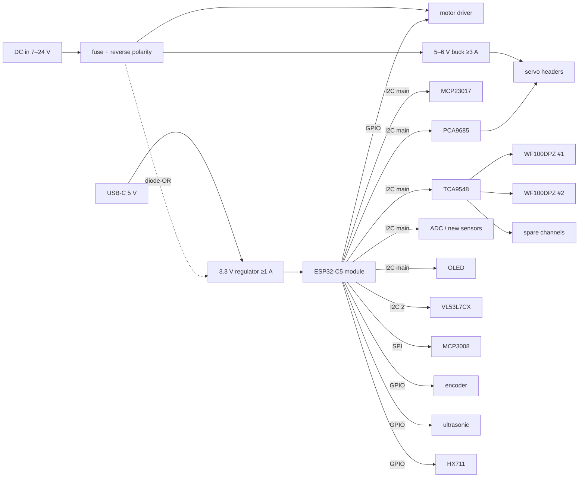

# SensorTestSetup PCB: specification (draft 0.1)

Status: **draft for review**. Decisions still open are marked **D1**, **D2**, ... (list at the end). Values marked
*(verify)* still have to be checked against a datasheet before they go into the schematic.

## 1. Purpose

Replace the breadboard with one PCB that carries as many of the sensors as possible, for the permanent desk setup used
to explain and try out sensors and actuators, and for the CloSer lab demos page.

Guiding requirements, in order:

1. **It always works.** Power on and every part works; a missing, broken or disconnected part never stops the rest.
2. **Every part can be explained.** Parts are visible, labelled on the silkscreen with name, bus and address/pins,
   and have test points for the scope / logic analyser.
3. **Easy to extend.** Spare connectors on each bus, so a new sensor can be tried without a new board.
4. **The current firmware keeps working** with as few changes as possible (`firmware/main/board.h` and the drivers).

## 2. Lessons from the breadboard and the ESP-IDF firmware

| # | Finding | Consequence for the PCB |
| --- | --- | --- |
| L1 | The ESP32-C5 has 29 GPIOs; after flash/PSRAM, USB and the console **only GPIO27 is free** (pin table in section 7). | New on-board parts go on I2C (or replace a GPIO part); not on new GPIOs. |
| L2 | Four signals are on **strapping pins** (SDA on 2, SCLK on 7, OLED CS on 25, MCP3008 CS on 28) *(verify the C5 strap list)*. | Move them off strapping pins where possible, or give them pull resistors that keep the boot levels right. |
| L3 | **I2C address clash:** the PCA9685's default All-Call address is 0x70, the same as the TCA9548. It works only because the firmware switches All-Call off before talking to the TCA9548. | TCA9548 at **0x71** (A0 high) or another address. Full address map in section 8. |
| L4 | The VL53L7CX firmware upload (~84 kB) **blocks the shared I2C bus** for seconds; the other parts timed out until the firmware split the upload into small pieces. | Give the VL53L7CX its own bus (the C5 has a second, LP I2C) or run its bus at 1 MHz with proper pull-ups. |
| L5 | The HC-SR04 runs at 5 V; its **ECHO output is 5 V** into a 3.3 V GPIO *(verify the current wiring)*. | Level shifting (divider or buffer), or a 3.3 V variant (HC-SR04P / RCWL-1601). |
| L6 | The **L298N** is a bipolar driver: ~2 V drop, gets hot, no current sense. | A modern driver with current sense (section 6). |
| L7 | The motor and the logic share supplies on the breadboard; the boards dropped off USB a few times during testing *(cause not proven)*. | Separate motor and servo supplies, a star ground, bulk capacitors, and the logic powered through its own regulator. |
| L8 | A sensor with a fixed address (WF100DPZ, 0x6D) needs the multiplexer to have two of them. | Keep the TCA9548: its spare channels also let students connect several identical sensors. |
| L9 | Breadboard contacts are the main cause of "unreliable". | Everything soldered or on keyed, locking connectors. |

## 3. Requirements

### Function
* **R1** All parts of the current setup work on the PCB (section 5), with the same firmware features.
* **R2** On-board where the part doesn't have to move or be handled: ADC, I/O expander, PWM driver, multiplexer,
  pressure sensors, load cell amplifier, motor driver, display, potentiometer, (new) environmental / motion sensors.
* **R3** Off-board on a connector where the part is mechanical or has to point somewhere: motor with encoder, servos,
  load cell, ultrasonic sensor, ToF sensor (or on-board facing up: **D4**), MH sensor module.
* **R4** At least 2 spare connectors per bus type: I2C (Qwiic/STEMMA QT, 3.3 V), servo headers, an analog input, a
  digital input/output (through the MCP23017).
* **R5** USB-C for power and programming (the C5's native USB: flashing and the console, no USB-UART chip needed).

### Power
* **R6** Runs from **USB-C alone** with everything except the motor and servos (or with them at low load: **D2**).
* **R7** A separate input (DC jack or screw terminal, 7–24 V) for the motor and servos.
* **R8** The 3.3 V rail can deliver ≥ 1 A (ESP32-C5 Wi-Fi peaks ~0.5 A, VL53L7CX ~0.1 A, the rest ~0.1 A).
* **R9** Servos on their own 5–6 V rail, ≥ 3 A, from the motor input.
* **R10** Reverse-polarity protection and a resettable fuse on every power input; TVS / ESD protection on USB and on
  connectors that leave the board.

### Robustness ("always works")
* **R11** The board boots correctly whatever is (or isn't) plugged in: no off-board part can pull a strapping pin.
* **R12** An emergency stop / motor enable: a button (and connector) that cuts the motor driver's enable in hardware.
* **R13** Supply monitoring: the motor input voltage on an ADC input (the old README already had "12–24 V sens").
* **R14** Status LEDs: 3.3 V, 5 V, motor supply, one addressable RGB LED for the firmware (Wi-Fi / control state).
* **R15** Reset and boot buttons, test points on every bus and supply, labelled.

### Mechanical
* **R16** Fits the desk setup: about 100 × 150 mm *(D5)*, four M3 mounting holes, all connectors on two edges,
  silkscreen labels readable from above.
* **R17** The display and the potentiometer reachable from the front edge.

## 4. Block diagram

## 5. Parts

### Kept from the current setup

| Part | Interface | On PCB? | Notes |
| --- | --- | --- | --- |
| ESP32-C5 | — | yes | Module, not a DevKit: **ESP32-C5-WROOM-1 N16R8** *(D1)*. Same chip, flash and PSRAM as now. |
| SSD1306 OLED 128×64 | SPI now | yes | Shows Wi-Fi, IP and the access code. Move to I2C (0x3C) to free 2 pins, or a bigger display *(D3)*. |
| MCP3008 | SPI | yes | Classic SPI teaching example; keep on SPI. Potentiometer (ch 7) on board; other channels on a header. |
| Potentiometer | MCP3008 ch 7 | yes | Panel-style with a knob, front edge. Also drives the motor's "follow the pot" mode. |
| MH sensor module | MCP3008 ch 6 | connector | Analog input header (3 pins). |
| MCP23017 | I2C 0x20 | yes | 16 I/O: bank A outputs to on-board LEDs (with a jumper to a header), bank B inputs on a header + 2 buttons. |
| PCA9685 | I2C 0x40 | yes | 16 servo headers (3-pin, 0.1"), on the servo rail. |
| TCA9548 | I2C 0x70 → **0x71** | yes | Channels 0–1: pressure sensors; channels 2–7: spare connectors (Qwiic). |
| 2× WF100DPZ | I2C 0x6D (via mux) | yes | With hose barbs on the board edge. |
| VL53L7CX | I2C 0x29 | **D4** | On a small board on a cable (to point it), or on-board facing up. Own I2C bus (L4). |
| HC-SR04 | GPIO trig/echo | connector | 4-pin; level shifting on ECHO (L5). |
| HX711 | GPIO | yes | Load cell on a 4-pin locking connector (E+, E−, A+, A−); RATE pin on a jumper (10/80 Hz). |
| Motor driver | GPIO (PWM ×2) | yes | Replace the L298N: **DRV8874** or **DRV8871** (H-bridge with current sense, ≥ 2 A) *(verify)*; enable through the emergency stop. |
| Gear motor + encoder | encoder → GPIO | connector | 6-pin: M+, M−, encoder VCC (3.3 V), GND, A, B. |

### Candidates to add on board (all I2C, so no extra GPIOs)

Proposed by teaching value and cost; pick in **D6**.

| Part | What it shows | Address *(verify)* | Priority |
| --- | --- | --- | --- |
| IMU, e.g. LSM6DSO or ICM-42688 | acceleration, rotation (tilt the board) | 0x6A | high |
| BME280 / BME688 | temperature, humidity, air pressure (vs. the gauge sensors) | 0x76 | high |
| INA226 on the motor supply | current and power of the motor and servos | 0x44 (not 0x40: PCA9685) | high |
| AS5600 magnetic angle sensor + knob | absolute angle vs. the potentiometer and the encoder | 0x36 | medium |
| VEML7700 light sensor | ambient light | 0x10 | medium |
| ADS1115 16-bit ADC | precision vs. the MCP3008's 10 bits | 0x48 | medium |
| Addressable RGB LED (WS2812/SK6812) | status, and PWM/colour demos | GPIO27 | high |
| Buzzer (via PCA9685 channel) | PWM frequency demo | — | low |
| I2S MEMS microphone | sound level | needs 3 GPIOs | low (no pins) |

## 6. Power

| Rail | Source | Load | Proposal |
| --- | --- | --- | --- |
| 5 V USB | USB-C (5 V, up to 1.5 A with CC resistors) | regulator, HC-SR04, VL53L7CX AVDD | polyfuse + TVS |
| 3.3 V | LDO or buck from 5 V (or from the motor input via diode-OR) | C5, sensors, OLED, encoder | ≥ 1 A, e.g. a buck (AP63203) *(verify)* rather than an LDO for the heat |
| Servo 5–6 V | buck from the DC input | 16 servo headers | ≥ 3 A, jumper for 5 / 6 V |
| Motor | DC input 7–24 V directly | motor driver | bulk capacitor ≥ 100 µF, reverse-polarity MOSFET, polyfuse |

Grounds: one ground plane, with the motor and servo return currents kept away from the ESP32 and the analog parts
(star point near the DC input). The MCP3008 gets its own filtered reference (RC or a reference IC).

## 7. Pins

ESP32-C5: GPIO 0–28; ADC on GPIO 1–6; USB on 13/14; console UART on 11/12; the module's flash and PSRAM use the pins
the DevKit doesn't bring out (15–22) *(verify for the WROOM-1 N16R8)*. Strapping pins *(verify)*: 2, 7, 25, 27, 28.

| GPIO | Now (breadboard) | Proposal for the PCB |
| --- | --- | --- |
| 0 | SPI MISO | SPI MISO |
| 1 | HX711 SCK | ADC: motor supply voltage (R13) — HX711 SCK moves |
| 2 | I2C SDA (strap) | HX711 SCK (strap-safe: output, idle low *(verify level)*) |
| 3 | I2C SCL | I2C SCL |
| 4 | encoder B | encoder B |
| 5 | HX711 DOUT | HX711 DOUT |
| 6 | HC-SR04 trig | HC-SR04 trig |
| 7 | SPI SCLK (strap) | SPI SCLK (keep; pull-down per strap level *(verify)*) |
| 8 | SPI MOSI | SPI MOSI |
| 9 | OLED D/C | I2C SDA (main bus) |
| 10 | HC-SR04 echo | HC-SR04 echo (level shifted) |
| 11/12 | console UART | spare / test points (console is on USB) |
| 13/14 | USB | USB-C |
| 23/24 | motor IN2/IN1 | motor IN2/IN1 |
| 25 | OLED CS (strap) | LP I2C / second bus for the VL53L7CX *(verify which pins the LP I2C can use)* |
| 26 | encoder A | encoder A |
| 27 | free (strap) | RGB status LED (output only, strap-safe level *(verify)*) |
| 28 | MCP3008 CS (strap, BOOT button) | MCP3008 CS (keep: idle high = normal boot) |

This frees pins by moving the OLED to I2C (**D3**); the emergency stop works in hardware on the driver's enable and
is read back through the MCP23017.

## 8. I2C addresses

| Address | Main bus | Behind the TCA9548 | Second bus |
| --- | --- | --- | --- |
| 0x20 | MCP23017 | | |
| 0x29 | | | VL53L7CX |
| 0x36 | AS5600 (candidate) | | |
| 0x3C | SSD1306 (if on I2C) | | |
| 0x40 | PCA9685 | | |
| 0x44 | INA226 (candidate) | | |
| 0x48 | ADS1115 (candidate) | | |
| 0x6A | IMU (candidate) | | |
| 0x6D | | WF100DPZ ch 0 and ch 1 | |
| 0x70 | (PCA9685 All-Call: off in firmware) | | |
| 0x71 | TCA9548 | | |
| 0x76 | BME280 (candidate) | | |

Pull-ups: 2.2 kΩ on each bus, on the board (not on the plug-in modules), with jumpers to remove them.

## 9. Connectors

| Connector | Type | Count |
| --- | --- | --- |
| USB-C | USB 2.0, 5 V | 1 |
| Motor/servo power in | DC jack 5.5/2.1 mm + 2-pin screw terminal | 1 |
| Motor + encoder | JST-PH 6-pin (or XH) | 1 |
| Servos | 3-pin 0.1" headers (GND, V+, signal), keyed by silkscreen | 16 (or 8: **D7**) |
| Load cell | JST-PH 4-pin | 1 |
| HC-SR04 | 4-pin 0.1" socket or JST-PH | 1 |
| ToF | JST-SH 6-pin (I2C + power + INT/LPn) | 1 |
| I2C spare | Qwiic / STEMMA QT (JST-SH 4-pin, 3.3 V) | 2 main bus + 6 behind the TCA9548 |
| Analog in | 3-pin (GND, 3.3 V, signal) for MCP3008 ch 0–6 | 7 |
| MCP23017 bank B | 2×5 header (8 I/O, GND, 3.3 V) | 1 |
| Emergency stop | 2-pin, normally closed, jumper if unused | 1 |

## 10. Firmware impact

Each item is a small change in `firmware/main/board.h` plus the driver named:

* OLED on I2C (if chosen): `display.c` from SPI to I2C (u8g2 supports both).
* TCA9548 at 0x71: one constant in `i2cbus.c`.
* VL53L7CX on its own bus: `tof.cpp` creates a second bus instead of `i2cbus_bus()`.
* New motor driver: same two PWM inputs; add current sense (ADC) and the enable read-back.
* New I2C sensors: each gets a reader in `i2cbus.c`, a `/ws` topic and a page, like the existing ones; the matrix can use
  them as inputs.

## 11. Open decisions

| # | Decision | Recommendation |
| --- | --- | --- |
| D1 | ESP32-C5 module on the board, or a socket for the DevKit | Module (WROOM-1 N16R8): smaller, no loose board; the DevKit is easy to swap but adds a second USB and loose pins. |
| D2 | Must the motor and servos work from USB alone? | No: from the DC input only, with the USB powering the logic. USB can't deliver servo stall currents. |
| D3 | Display: keep the 0.96" SSD1306 (on I2C), a 1.3" SH1106, or a colour TFT (ST7789, SPI) | 1.3" SH1106 on I2C: bigger, same driver family (u8g2), frees two pins. |
| D4 | ToF sensor on the board (facing up) or on a cable | On a cable: it can be aimed at things, and replaced. |
| D5 | Board size and mounting | ~100 × 150 mm, 4× M3, in the current desk position. |
| D6 | Which new on-board sensors (section 5) | IMU, BME280, INA226 and the RGB LED; AS5600 if there is room. |
| D7 | 16 or 8 servo headers | 8 on the board (the PCA9685's other 8 channels on a header). |
| D8 | Keep the L298N footprint for the existing module, or a new driver chip | New driver chip (L6). |
| D9 | Who designs the PCB (in-house, student, JLCPCB assembly) and the budget | — |

## 12. Next steps

1. Review this draft; settle D1–D9.
2. Verify the items marked *(verify)*: strapping pins, LP I2C pins, flash/PSRAM pins of the module, driver and
   regulator parts, sensor addresses.
3. Complete the schematic in `OfficeDeskSetup/` (it has the DevKit, MCP3008, MCP23017, TCA9548, L298N and the pot now).
4. Layout, order, and bring-up with the firmware, part by part (the firmware already reports each part as found or not).
